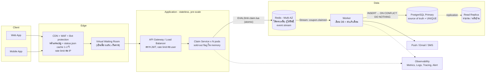
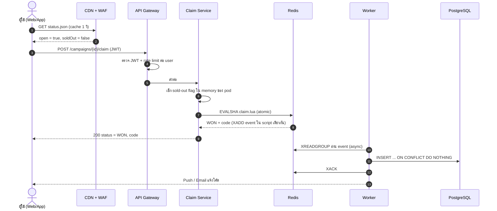

# ข้อ 1.1 — High-Level System Architecture: Flash Sale แจกโค้ด 1,000 สิทธิ์

> **โจทย์:** แจกโค้ดส่วนลด 1,000 สิทธิ์ เปิดกดพร้อมกัน 12:00 น. ผู้ใช้ประมาณ 50,000 คน เข้ามาภายใน 5 นาทีแรก ทั้ง Web และ Mobile App
> ใช้ Tech Stack / Component อะไร เพื่อให้ระบบไม่ล่ม

---

## 1. ตีโจทย์ด้วยตัวเลขก่อนออกแบบ

| รายการ | ค่า | หมายเหตุ |
|---|---|---|
| ผู้ใช้ทั้งหมด | 50,000 คน / 5 นาที | ค่าเฉลี่ย ≈ 170 คน/วินาที — **ตัวเลขนี้หลอกตา** |
| ช่วง peak จริง | สมมติ 60% (30,000 คน) เข้ามาใน 10 วินาทีแรก | ≈ 3,000 คน/วินาที — **สมมติฐาน** ต้องยืนยันด้วยข้อมูล analytics ของแคมเปญก่อนหน้า ถ้ามี |
| Request ต่อคน | ~5 (เปิดหน้า, เช็กสถานะ, กดซ้ำ, รีเฟรช) | คนกด Flash Sale มักกดรัว |
| Peak ที่หน้าบ้าน | ≈ 15,000 req/s | **ออกแบบเผื่อ 2 เท่า = 30,000 req/s** |
| โค้ดหมดเมื่อไร | 1,000 โค้ด / 3,000 คนต่อวินาที → หมดภายใน ~1 วินาที | |
| คนที่ไม่ได้ | 49,000 คน (**98%**) | |

**ข้อสรุปที่ใช้ออกแบบ**

> ปัญหาจริงไม่ใช่ "แจก 1,000 โค้ด" แต่คือ **"ปฏิเสธ 49,000 คนให้เร็ว ถูก และไม่ลาก Database ล่มไปด้วย"**

### หลักการออกแบบ 5 ข้อ

1. **Reject early** — ตัดคำขอที่ไม่มีทางได้สิทธิ์ทิ้งที่ชั้นนอกสุดที่ทำได้ (Client → CDN → Gateway → Service) ก่อนถึงชั้นข้อมูล
2. **Hot path อยู่ใน memory** — การตัดสินว่า "ใครได้โค้ด" เกิดใน Redis ไม่ใช่ Database
3. **เขียน Database แบบ asynchronous** — ผ่าน Stream/Queue ให้ Worker ทยอยเขียน (Peak shaving) DB จึงเห็นแค่ ~1,000 แถว
4. **ทุกชั้น stateless และ scale แนวนอนได้** — และ **pre-scale ก่อนเวลา** เพราะ autoscale ตามไม่ทัน spike ที่ 12:00:00
5. **Bulkhead** — แยกทรัพยากรของแคมเปญออกจากระบบหลัก ถ้าแคมเปญมีปัญหา ระบบสั่งซื้อ / login ปกติต้องไม่ล่มตาม

---

## 2. Architecture Diagram

---

## 3. Component และ Tech Stack

> ใช้ AWS เป็นตัวอย่าง — แนวคิดเดียวกันใช้กับ Azure / GCP / On-premise ได้ (เทียบชื่อบริการในคอลัมน์ "ทางเลือก")

| ชั้น | Component | Tech ที่เลือก | ทางเลือก | หน้าที่ / เหตุผล |
|---|---|---|---|---|
| Client | Web, Mobile App | Next.js, Flutter / React Native | — | ปุ่มเปิดตาม **เวลาของ server**, disable ปุ่มทันทีหลังกด, retry แบบ backoff + jitter, เห็น sold out แล้วหยุดยิง |
| Edge | CDN + WAF + Bot management | CloudFront + AWS WAF | Cloudflare, Akamai | cache หน้าแคมเปญและ `status.json` (TTL 1–2 วิ) จึงรับ request ส่วนใหญ่แทน server, block bot, rate limit ต่อ IP |
| Edge (สำรอง) | Virtual Waiting Room | AWS Virtual Waiting Room | Cloudflare Waiting Room, Queue-it | ปล่อยคนเข้า N คน/วินาที เมื่อ traffic เกินที่ประเมิน — เปิดได้ด้วย config ไม่ต้อง deploy |
| Entry | API Gateway / Load Balancer | ALB + API Gateway | Kong, NGINX, Azure APIM | ตรวจ JWT ด้วย signature (**ไม่แตะ DB**), rate limit ต่อ user (เช่น 1 req/วินาที), kill switch ของแคมเปญ |
| App | Claim Service (stateless) | Go / .NET / Node.js บน EKS | ECS, AKS, GKE | ตรรกะแจกโค้ด, endpoint เบามาก, **pre-scale** ก่อน 11:45 แล้วใช้ HPA เป็นตัวเสริม |
| Cache / Stock | Redis | ElastiCache (Multi-AZ, replica คนละ AZ) หรือ Amazon MemoryDB ถ้ายอมให้ write หายไม่ได้เลย | Azure Cache for Redis, Redis Enterprise | เก็บโค้ดคงเหลือ, ผู้ได้สิทธิ์, sold-out flag, rate-limit counter; **ตัดสินสิทธิ์ด้วย Lua script แบบ atomic** (รายละเอียดข้อ 1.2) — replica ของ ElastiCache เป็น asynchronous จึงยังมีโอกาสเสีย write ล่าสุดตอน failover ส่วน MemoryDB เขียนลง transaction log หลาย AZ ก่อนตอบ แลกกับ latency ที่สูงขึ้นเล็กน้อย |
| Messaging | Event stream / Queue | Redis Streams (ใน hot path) | Kafka (MSK), SQS, RabbitMQ | event "ได้โค้ด" ถูกเขียนใน Lua script เดียวกับการตัดสิทธิ์ → ไม่มีปัญหา dual-write; ถ้ามีหลายระบบต้องรู้ event ค่อยส่งต่อเข้า Kafka/SQS |
| Worker | DB Writer, Notifier | container image เดียวกับ service | Lambda | อ่าน stream → INSERT แบบ idempotent → ส่ง Push/Email/SMS, retry + dead-letter |
| Data | RDBMS | PostgreSQL (RDS / Aurora) + Read Replica | MySQL, SQL Server | source of truth, **UNIQUE constraint เป็นด่านสุดท้ายกันแจกซ้ำ/แจกเกิน**, รายงานอ่านจาก replica |
| Ops | Observability | Prometheus + Grafana, Loki/ELK, OpenTelemetry | Datadog, CloudWatch | dashboard real-time: RPS, p95 latency, error rate, โค้ดคงเหลือ, stream lag + alert |
| Test | Load / Spike test | k6 | JMeter, Locust, Gatling | ยิง 2–3 เท่าของที่ประเมินก่อนวันจริง พร้อมทดสอบ concurrency |

---

## 4. Flow การทำงานของ 1 คำขอ

ผู้ใช้ได้คำตอบทันทีจาก Redis (หลักมิลลิวินาที) ส่วน Database ถูกเขียนตามหลังโดย Worker ด้วยอัตราที่เราควบคุมเอง

---

## 5. ทำไมไม่ให้ทุกคำขอวิ่งไป Database ตรง ๆ

| ถ้าใช้ DB ตัดสต็อกตรง ๆ | ผลที่เกิด |
|---|---|
| 15,000 req/s แย่งแก้แถวเดียว (stock counter) | row lock contention — ทุก transaction ต่อคิวกันที่แถวเดียว |
| connection pool เต็ม (เช่น 500 connections) | request ที่เหลือ timeout → client retry → **retry storm** ซ้ำเติม |
| DB ตัวเดียวกันใช้กับระบบสั่งซื้อ / login | **ล่มทั้งบริษัท ไม่ใช่แค่แคมเปญ** |

Redis ทำงานใน memory ได้หลักแสน operation/วินาทีต่อ node และประมวลผลคำสั่งทีละคำสั่ง (single-threaded) จึงเหมาะกับการตัดสินสิทธิ์แบบ atomic ส่วน DB ถูกใช้ในงานที่มันเก่งคือเก็บข้อมูลถาวรและบังคับความถูกต้อง

---

## 6. Capacity Planning

ตัวเลขทุกตัวในส่วนนี้เป็น **ค่าตั้งต้นสำหรับ load test** ไม่ใช่ค่าที่ใช้จริงทันที ขนาดจริงคำนวณจากผลวัดตามสูตรด้านล่าง

**ขั้นตอนหาขนาด**
1. Load test **pod เดียว** ของ Claim Service จนถึงจุดที่ p95 latency เกินเป้าที่ตั้งไว้ → ได้ `R_pod` (req/s ต่อ pod)
2. จำนวน pod = `ceil(peak_rps / R_pod) × 2` (เผื่อ 2 เท่าสำหรับ traffic เกินคาดและ pod ที่ตายระหว่างทาง)
3. Load test ทั้งระบบที่ 2–3 เท่าของ peak เพื่อยืนยัน

| Component | ค่าตั้งต้นก่อนทดสอบ | ที่มา / เหตุผล |
|---|---|---|
| Claim Service | 20 pods (pre-scale) | ถ้าวัดได้ `R_pod` ≈ 1,500 req/s → `ceil(15,000 / 1,500) × 2 = 20` |
| Redis | 1 primary + 1 replica (คนละ AZ) | ทุก key ของแคมเปญอยู่ slot เดียว (hot key) การเพิ่ม shard จึงไม่ช่วย — ต้องวัดเพดาน Lua script/วินาทีของ node เดียว |
| Stream / Queue | ~1,000 messages | เล็กมาก |
| Worker | 2–3 instances, DB pool ละ 5 connections | คุม load ที่ DB ให้คงที่ |
| PostgreSQL | ไม่ต้องขยาย | เขียนแค่ ~1,000 แถว |

**ทำไม Redis node เดียวพอ:** คำขอที่ถึง Redis จริงมีแค่ช่วงก่อนโค้ดหมด (ประมาณวินาทีแรก) หลังจากนั้น sold-out flag ใน pod และ `status.json` บน CDN ตัดคำขอทิ้งก่อนถึง Redis

**ถ้าผล load test พบว่า node เดียวไม่พอ:** แบ่งโค้ดเป็น N ชุดไว้คนละ shard แล้วส่ง user ไป shard ตาม `hash(user_id) mod N` — user คนเดิมไป shard เดิมเสมอ กฎ "1 คน 1 สิทธิ์" จึงยังถูกต้อง trade-off คือบาง shard อาจหมดก่อนทั้งที่ shard อื่นยังเหลือ ต้องมี job ย้ายโค้ดที่เหลือมาเติม

---

## 7. Single Point of Failure และการรับมือเมื่อล้มเหลว

### 7.1 ไล่หา Single Point of Failure

| Component | เป็น SPOF ไหม | เหตุผล / วิธีลดความเสี่ยง |
|---|---|---|
| CDN, WAF, Load Balancer | ไม่ | managed service กระจายหลาย AZ / หลาย POP อยู่แล้ว |
| Claim Service | ไม่ | stateless หลาย pod กระจายคนละ AZ ตัวไหนตายก็แค่ถูกตัดออกจาก LB |
| **Redis primary** | **ใช่ (ของแคมเปญนี้)** | ทุกการตัดสินสิทธิ์ต้องผ่าน node นี้ — ลดความเสี่ยงด้วย replica คนละ AZ + auto-failover (~10–30 วิ) และ **fail closed** ระหว่าง failover; ยอมรับได้เพราะกระทบแค่แคมเปญ ไม่กระทบระบบหลัก |
| Redis Stream (event) | อยู่บน Redis ตัวเดียวกัน | ถ้า write ล่าสุดหายตอน failover → event หายด้วย → ใช้ `WAIT` + reconcile (ดูข้อ 1.2) |
| Worker | ไม่ | หลาย instance ใน consumer group เดียวกัน งานค้างถูกเก็บต่อด้วย `XAUTOCLAIM` |
| PostgreSQL primary | ไม่อยู่ใน hot path | ถ้าล่ม event รออยู่ใน stream ผู้ใช้ไม่รู้สึก เขียนต่อได้เมื่อ DB กลับมา (Multi-AZ failover) |
| Config แคมเปญ / เวลาเปิด | ไม่ | preload ใน memory ของทุก pod และใน Redis ก่อนเวลา |
| คนตัดสินใจตอนเกิดเหตุ | **ใช่ ถ้าไม่เตรียม** | กำหนด incident commander + runbook + kill switch ล่วงหน้า |

### 7.2 การรับมือแต่ละเหตุการณ์

| เหตุการณ์ | การรับมือ |
|---|---|
| Redis primary ล่ม | auto-failover ไป replica; ระหว่างนั้น API ตอบ `503 + Retry-After` (**fail closed**) — **ห้าม fallback ไปตัดสต็อกที่ DB** เพราะจะลาก DB ล่ม; จบแคมเปญแล้ว reconcile Redis กับ DB |
| Worker / DB ช้า | event ค้างใน stream ไม่กระทบผู้ใช้ เพราะผู้ใช้ได้คำตอบแล้ว; worker ตัวอื่นเก็บงานค้างด้วย `XAUTOCLAIM` |
| Traffic เกินคาด 3–5 เท่า | เปิด Waiting Room / ลด rate limit ผ่าน config ทันที |
| Bot ยิงรัว | WAF + bot management + ต้อง login + ยืนยันเบอร์โทรก่อนเข้าร่วมแคมเปญ |
| นาฬิกาเครื่องผู้ใช้เดินเร็ว | server ตัดสินเวลาเปิด (ใช้นาฬิกาของ Redis), client แค่แสดง countdown ที่ sync กับ server |
| Login storm ตอน 12:00 | ให้ผู้ใช้ login ก่อนเวลา, token อายุพอครอบช่วงแคมเปญ, gateway ตรวจ JWT เองไม่ต้องถาม DB |

---

## 8. Checklist ก่อนวันจริง

- [ ] Load test / spike test 2–3 เท่า + concurrency test (ดูข้อ 1.2)
- [ ] Pre-scale service, worker, Redis ก่อนเวลา 15–30 นาที
- [ ] Preload โค้ด 1,000 ตัวเข้า Redis และนับยืนยันตรงกับ DB
- [ ] เตือนผู้ใช้ให้ login ก่อน 12:00
- [ ] Kill switch / feature flag ปิดแคมเปญได้ทันทีโดยไม่ต้อง deploy
- [ ] Dashboard + alert + runbook + war room (ใครตัดสินใจอะไรเมื่อเกิดเหตุ)
- [ ] แจ้ง Cloud / CDN provider ล่วงหน้าถ้าคาดว่า traffic สูงผิดปกติ
- [ ] หลังจบ: reconcile จำนวนโค้ดใน Redis = DB = 1,000 แล้วสรุป post-campaign review

---

ต่อ: [ข้อ 1.2 — Logic แก้ Concurrency / Race Condition](./1.2-concurrency-logic.md)
