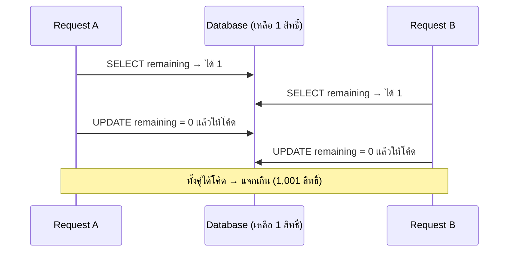

# ข้อ 1.2 — Logic แก้ Concurrency (Race Condition): ไม่ให้แจกซ้ำ และไม่ให้แจกเกิน 1,000 สิทธิ์

> ต่อจาก [ข้อ 1.1](./1.1-high-level-architecture.md) — ใช้ Architecture เดียวกัน

---

## 1. Race Condition เกิดตรงไหน

รูปแบบคลาสสิกคือ **check-then-act** — อ่านค่า แล้วค่อยตัดสินใจ แล้วค่อยเขียน โดยระหว่างนั้นมีคำขออื่นแทรกได้



### ปัญหาที่ต้องกัน 4 แบบ

| # | ปัญหา | ตัวอย่างที่ทำให้เกิด |
|---|---|---|
| 1 | **แจกเกิน 1,000** (Overselling) | สองคำขออ่านสต็อกเหลือ 1 พร้อมกัน |
| 2 | **คนเดียวได้หลายโค้ด** | กดรัว, เปิด Web + App พร้อมกัน |
| 3 | **โค้ดเดียวถึงมือสองคน** | สร้าง / สุ่มโค้ดตอนแจกแล้วชนกัน |
| 4 | **Retry แล้วได้ซ้ำ** | network timeout แล้ว client ยิงซ้ำ |

---

## 2. แนวทางที่เลือก: ป้องกันหลายชั้น (Defense in Depth)


ชั้น 1–3 **ลด load** แต่เชื่อถือเพื่อความถูกต้องไม่ได้ (client แก้ได้, pod มีหลายตัว)
ความถูกต้องจริงอยู่ที่ **ชั้น 4 (Redis Lua)** และ **ชั้น 5 (Database constraint)**

### ชั้น 1 — Client
- disable ปุ่มทันทีหลังกด และแสดงสถานะ "กำลังดำเนินการ"
- retry อัตโนมัติแบบ exponential backoff + jitter (ไม่ให้ทุกเครื่อง retry พร้อมกัน)
- เมื่อได้ `SOLD_OUT` หรืออ่าน `status.json` ว่าหมดแล้ว → หยุดยิงทันที

### ชั้น 2 — API Gateway
- rate limit ต่อ `user_id` (เช่น 1 req/วินาที, token bucket ใน Redis) → คืน `429 Too Many Requests`
- คำขอต้องมี JWT ที่ valid — คนไม่ login ไปไม่ถึง service

### ชั้น 3 — Claim Service
- เก็บ sold-out flag ใน memory ของแต่ละ pod เมื่อรู้ว่าหมดแล้ว คำขอถัดไปตอบ `SOLD_OUT` ได้ทันทีโดยไม่ต้องถาม Redis

### ชั้น 4 — Redis + Lua Script (ตัวตัดสินสิทธิ์)

**ทำไมต้อง Lua:** Redis รัน Lua script ทั้งก้อน **โดยไม่มีคำสั่งอื่นแทรกกลาง** ทำให้ขั้น "เช็กว่าเคยได้หรือยัง → หยิบโค้ด → บันทึกผู้ได้ → ส่ง event" กลายเป็นขั้นตอนเดียวที่แบ่งไม่ได้ (atomic) จึงไม่มีช่องให้เกิด race condition

**ข้อมูลที่เตรียมไว้ก่อนเปิดแคมเปญ**

| Key | Type | เนื้อหา |
|---|---|---|
| `flash:{c1}:codes` | LIST | โค้ด 1,000 ตัวที่สร้างไว้ล่วงหน้า (ไม่ซ้ำกัน, ตรงกับตาราง `coupon_code` ใน DB) |
| `flash:{c1}:winners` | HASH | `user_id → code` |
| `flash:{c1}:soldout` | STRING | `"1"` เมื่อโค้ดหมด |
| `flash:{c1}:events` | STREAM | event ให้ Worker เขียนลง DB |

`{c1}` คือ hash tag ทำให้ทุก key ของแคมเปญเดียวกันอยู่ slot เดียวกันใน Redis Cluster (Lua script ต้องใช้ key ใน slot เดียวกัน)

**ทำไมสร้างโค้ดไว้ล่วงหน้าเป็น LIST:** `LPOP` หยิบได้ไม่เกินจำนวนที่มีใน LIST → **แจกเกิน 1,000 เป็นไปไม่ได้ในเชิงโครงสร้าง** และแต่ละโค้ดถูกหยิบได้ครั้งเดียว → แก้ปัญหาข้อ 1 และ 3 พร้อมกัน

```lua
-- claim.lua : ตัดสินสิทธิ์ 1 ครั้งแบบ atomic (Redis 7+)
-- KEYS[1] flash:{c1}:codes    LIST   โค้ดที่ยังไม่ถูกแจก
-- KEYS[2] flash:{c1}:winners  HASH   user_id -> code
-- KEYS[3] flash:{c1}:soldout  STRING "1" เมื่อหมด
-- KEYS[4] flash:{c1}:events   STREAM event ให้ worker เขียน DB
-- ARGV[1] user_id
-- ARGV[2] start_at (epoch ms)

-- ใช้นาฬิกาของ Redis เป็นนาฬิกากลาง ไม่เชื่อนาฬิกาของ client หรือของแต่ละ pod
local t = redis.call('TIME')
local now_ms = tonumber(t[1]) * 1000 + math.floor(tonumber(t[2]) / 1000)
if now_ms < tonumber(ARGV[2]) then
  return {'NOT_STARTED', ''}
end

-- 1 คน 1 สิทธิ์: ถ้าเคยได้แล้ว คืนโค้ดเดิม (กดซ้ำ / retry ปลอดภัย)
local mine = redis.call('HGET', KEYS[2], ARGV[1])
if mine then
  return {'ALREADY_CLAIMED', mine}
end

-- หยิบโค้ด 1 ตัว ถ้าไม่เหลือ = หมด
local code = redis.call('LPOP', KEYS[1])
if not code then
  redis.call('SET', KEYS[3], '1')
  return {'SOLD_OUT', ''}
end

-- บันทึกผู้ได้สิทธิ์ + ส่ง event ใน script เดียวกัน (ไม่มี dual-write)
redis.call('HSET', KEYS[2], ARGV[1], code)
redis.call('XADD', KEYS[4], '*', 'user_id', ARGV[1], 'code', code, 'at', tostring(now_ms))
return {'WON', code}
```

**Claim Service (pseudocode)**

```ts
const localSoldOut = new Set<string>();          // cache ใน memory ของ pod

export async function claim(campaignId: string, userId: string) {
  if (localSoldOut.has(campaignId)) return { status: 'SOLD_OUT' };   // ไม่ต้องไป Redis

  const c = campaignConfig.get(campaignId);       // preload ไว้ใน memory ก่อนเปิดแคมเปญ
  const k = (name: string) => `flash:{${campaignId}}:${name}`;

  const [status, code] = await redis.evalsha(
    CLAIM_SHA, 4,
    k('codes'), k('winners'), k('soldout'), k('events'),
    userId, c.startAtMs,
  ) as [string, string];

  if (status === 'SOLD_OUT') localSoldOut.add(campaignId);

  if (status === 'WON') {
    // รอให้ replica ได้รับ write อย่างน้อย 1 ตัว (สูงสุด 50 ms)
    // ลดโอกาสข้อมูลหายถ้า Redis primary ล่มพอดี — ทำแค่ 1,000 ครั้งจึงไม่กระทบ performance
    const acked = await redis.wait(1, 50);
    if (acked < 1) metrics.increment('claim.won_not_replicated');   // ยังตอบ WON แต่ติดธงให้ตรวจ

    // audit log แยกจาก Redis: ใช้ตรวจย้อนหลังว่า "บอกใครว่าได้" ถ้า Redis เสียข้อมูล
    auditLog.write({ type: 'CLAIM_WON', campaignId, userId, code, replicated: acked >= 1 });
  }

  return { status, code: code || undefined };
}
```

**ผลลัพธ์ที่ API คืน**

| status | HTTP | ความหมายต่อผู้ใช้ |
|---|---|---|
| `WON` | 200 | ได้โค้ด แสดงโค้ดทันที |
| `ALREADY_CLAIMED` | 200 | เคยได้แล้ว แสดงโค้ดเดิม |
| `SOLD_OUT` | 200 | สิทธิ์เต็มแล้ว |
| `NOT_STARTED` | 200 | ยังไม่ถึงเวลา |
| — | 429 | กดถี่เกินไป |
| — | 503 + `Retry-After` | ระบบไม่ว่างชั่วคราว ลองใหม่ได้ |

> `WON / SOLD_OUT` เป็นผลลัพธ์ทางธุรกิจ ไม่ใช่ error จึงคืน 200 พร้อม status — ทำให้ client และ monitoring แยก "ระบบพัง" ออกจาก "สิทธิ์หมด" ได้ชัด

### ชั้น 5 — Database เป็นด่านสุดท้าย

แม้ Redis ตัดสินถูกต้องแล้ว ก็ยังบังคับกฎซ้ำที่ DB เผื่อกรณีผิดปกติ (เช่น Redis failover แล้วเสีย write ล่าสุด, bug ในโค้ด, ข้อมูลถูกแก้มือ)

```sql
-- โค้ด 1,000 ตัว สร้างไว้ล่วงหน้า (ชุดเดียวกับที่ preload เข้า Redis)
CREATE TABLE coupon_code (
  code         VARCHAR(16) PRIMARY KEY,
  campaign_id  BIGINT      NOT NULL
);

CREATE TABLE coupon_claim (
  id           BIGSERIAL   PRIMARY KEY,
  campaign_id  BIGINT      NOT NULL,
  user_id      BIGINT      NOT NULL,
  code         VARCHAR(16) NOT NULL REFERENCES coupon_code (code),
  claimed_at   TIMESTAMPTZ NOT NULL,
  CONSTRAINT uq_claim_user UNIQUE (campaign_id, user_id),   -- 1 คน 1 สิทธิ์
  CONSTRAINT uq_claim_code UNIQUE (code)                    -- 1 โค้ด 1 คน
);
```

- `REFERENCES coupon_code` + `UNIQUE (code)` → จำนวนแถวใน `coupon_claim` **ไม่มีทางเกินจำนวนโค้ดที่มีอยู่จริง (1,000)**
- `UNIQUE (campaign_id, user_id)` → คนเดียวได้สองโค้ดไม่ได้

**Worker** อ่าน event จาก stream (`XREADGROUP`) แล้วเขียนแบบ idempotent:

```sql
INSERT INTO coupon_claim (campaign_id, user_id, code, claimed_at)
VALUES ($1, $2, $3, to_timestamp($4 / 1000.0))
ON CONFLICT DO NOTHING;
```

- ถ้า insert สำเร็จ → `XACK`
- ถ้าชน constraint → ตรวจว่าแถวเดิมเป็น user + code เดียวกันไหม
  - ใช่ = event ซ้ำ (worker เคยทำไปแล้ว) → `XACK` ได้เลย
  - ไม่ใช่ = ข้อมูลไม่ตรงกัน → ส่งเข้า dead-letter + alert ให้คนตรวจ
- ถ้า worker ตายกลางทาง → event ยังค้างใน pending list → worker ตัวอื่นเก็บต่อด้วย `XAUTOCLAIM`

### กรณีเลวร้ายที่สุด: Redis primary ล่มก่อน replicate

Redis replication เป็นแบบ asynchronous ถ้า primary ล่ม **หลังตอบผู้ใช้ว่า WON แต่ก่อน replica ได้รับ write** ผลคือ

1. ผู้ใช้ A เห็นโค้ด X บนหน้าจอแล้ว แต่ HSET, LPOP และ event ใน stream หายไปพร้อม primary → DB ไม่มีบันทึกของ A
2. โค้ด X กลับมาอยู่ใน LIST → ผู้ใช้ B อาจได้โค้ด X ไปอีกคน

ลดโอกาสด้วย `WAIT` (หน้าต่างความเสี่ยงเหลือหลักมิลลิวินาที) แต่ตัดให้เป็นศูนย์ไม่ได้ จึงเตรียมทางแก้ไว้ล่วงหน้า:

| สิ่งที่เตรียม | ใช้ทำอะไร |
|---|---|
| **Audit log ของทุกคำตอบ `WON`** เขียนแยกจาก Redis (log pipeline ที่ทนทาน) | หลัง failover ใช้เทียบกับ DB ว่าใครถูกบอกว่าได้ แต่ไม่มีใน DB |
| **Reserve codes** เช่น 1% (10 โค้ด) เก็บแยกจากตาราง `coupon_code` ของแคมเปญ ออกโดยทีม ops เท่านั้น | ชดเชยผู้ใช้ที่ได้รับผลกระทบ แทนการบอกว่า "ที่เห็นบนจอไม่นับ" — ตาราง `coupon_claim` ยังมีได้ไม่เกิน 1,000 แถวเหมือนเดิม |
| **ข้อตกลงกับฝ่ายธุรกิจล่วงหน้า** | ยอมให้แจกเกินได้เฉพาะกรณีระบบผิดพลาดและจำกัดไม่เกินจำนวน reserve — เป็น business decision ไม่ใช่ technical decision |
| ถ้ายอมให้ write หายไม่ได้เลย | ใช้ Amazon MemoryDB ที่ยืนยัน write ลงหลาย AZ ก่อนตอบ แลกกับ latency ที่สูงขึ้น |

---

## 3. เปรียบเทียบทางเลือก และเหตุผลที่เลือก Redis + Lua

| วิธี | ทำงานอย่างไร | ข้อดี | ข้อเสียเมื่อมี 50,000 คน | ใช้ไหม |
|---|---|---|---|---|
| Pessimistic lock `SELECT ... FOR UPDATE` | ล็อกแถวสต็อกระหว่าง transaction | ถูกต้อง เข้าใจง่าย | ทุกคำขอต่อคิวที่แถวเดียว, connection pool เต็ม, DB ล่ม | ❌ |
| Optimistic lock (version column) | update เฉพาะเมื่อ version ยังไม่เปลี่ยน | ไม่ล็อก | ชนกันเกือบทุกครั้ง → retry storm | ❌ |
| Atomic conditional UPDATE `... SET remaining = remaining - 1 WHERE remaining > 0` | DB ตัดสินใน statement เดียว | ถูกต้อง ไม่ต้องมี Redis | ยังเป็น hot row และทุกคำขอแตะ DB | ⚠️ ใช้ได้กับ traffic หลักร้อย req/s |
| `FOR UPDATE SKIP LOCKED` บนตารางโค้ด | แต่ละ transaction หยิบแถวว่างคนละแถว ไม่รอกัน | ไม่ต่อคิว | ยังแตะ DB ทุกคำขอ | ⚠️ ทางสำรองเมื่อ traffic ไม่สูง |
| Distributed lock (Redlock) | ล็อกก่อนตัดสต็อก | — | ช้ากว่า, ซับซ้อน, ไม่จำเป็นเพราะ Lua atomic อยู่แล้ว | ❌ |
| Single-consumer queue | ทุกคำขอเข้าคิว ประมวลผลทีละตัว | ไม่มี race เลย | ผู้ใช้ต้องรอผลแบบ async, คิวยาว 50,000 | ⚠️ ใช้คู่กับ Waiting Room ได้ |
| **Redis + Lua script** | ตัดสินใน memory แบบ atomic | เร็วมาก, ถูกต้อง, ตอบผู้ใช้ทันที | ต้องดูแล durability และ reconcile กับ DB | ✅ **เลือก** |

---

## 4. Edge Cases

| สถานการณ์ | ผลลัพธ์ |
|---|---|
| กดรัว 10 ครั้ง | ครั้งแรก `WON`, ที่เหลือ `ALREADY_CLAIMED` (โค้ดเดิม) หรือโดน `429` |
| เปิด Web + App กดพร้อมกัน | Redis รัน script ทีละครั้ง → ได้ 1 โค้ด อีกฝั่งได้ `ALREADY_CLAIMED` |
| ได้โค้ดแล้วแต่ response หลุด แล้ว retry | ได้โค้ดเดิม เพราะ `(campaign, user)` เป็น natural idempotency key |
| คำขอที่ 1,001 | `SOLD_OUT` + ตั้ง flag ให้คำขอถัดไปไม่ต้องถึง Redis |
| กดก่อน 12:00:00 | `NOT_STARTED` (ใช้นาฬิกาของ Redis ตัดสิน) |
| Worker ตายกลางทาง | `XAUTOCLAIM` ให้ worker อื่นทำต่อ, INSERT เป็น idempotent |
| Redis failover แล้วเสีย write ล่าสุด | `WAIT` ลดโอกาส; ถ้าเกิดจริง DB UNIQUE กันโค้ดซ้ำ + เทียบ audit log กับ DB แล้วชดเชยด้วย reserve code (ดูหัวข้อกรณีเลวร้ายที่สุด) |
| คนเดียวสมัครหลายบัญชี | ไม่ใช่ race condition แต่เป็น fraud → กันด้วยยืนยันเบอร์โทร / device fingerprint / CAPTCHA ก่อนเข้าแคมเปญ |

---

## 5. วิธีพิสูจน์ว่ากันได้จริง

1. **Unit test** ของ `claim.lua` ทุก branch (NOT_STARTED, ALREADY_CLAIMED, SOLD_OUT, WON)
2. **Concurrency test** ด้วย k6 บน staging: ยิง 50,000 คำขอจาก 20,000 user (บางคนยิงซ้ำหลายครั้ง) พร้อมกันที่เวลาเปิด
3. **Chaos test** ระหว่างยิง: kill worker, สั่ง Redis failover
4. **ตรวจผลด้วย SQL** — ทุกข้อต้องผ่าน

```sql
-- ต้องได้ 1000 พอดี
SELECT COUNT(*) FROM coupon_claim WHERE campaign_id = 1;

-- ต้องไม่มีแถว: คนเดียวได้หลายโค้ด
SELECT user_id FROM coupon_claim
WHERE campaign_id = 1
GROUP BY user_id HAVING COUNT(*) > 1;

-- ต้องไม่มีแถว: โค้ดเดียวไปหลายคน
SELECT code FROM coupon_claim
GROUP BY code HAVING COUNT(*) > 1;
```

5. **Reconcile** หลังจบแคมเปญ: `HLEN flash:{c1}:winners` = จำนวนแถวใน DB = 1,000, `LLEN flash:{c1}:codes` = 0 และทุก `CLAIM_WON` ใน audit log มีแถวตรงกันใน DB

---

## สรุป

| ปัญหา | กันด้วย |
|---|---|
| แจกเกิน 1,000 | LIST มีโค้ด 1,000 ตัว `LPOP` ได้ไม่เกินนั้น + DB `FK + UNIQUE(code)` |
| คนเดียวได้หลายโค้ด | `HGET winners` ใน Lua (atomic) + DB `UNIQUE(campaign_id, user_id)` |
| โค้ดเดียวสองคน | โค้ดสร้างล่วงหน้าไม่ซ้ำ + `LPOP` หยิบได้ครั้งเดียว + DB `UNIQUE(code)` |
| Retry ได้ซ้ำ | script คืนโค้ดเดิมให้ user เดิม + worker insert แบบ `ON CONFLICT DO NOTHING` |
