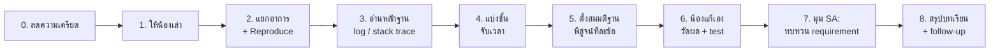
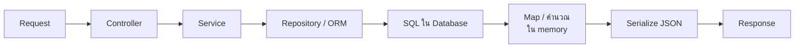

# ข้อ 2 — ช่วยและไกด์น้อง Junior ที่ API รายงานยอดขาย "ค้าง" และ "Error 500"

> **สถานการณ์:** น้องประเมินงานไว้ 2 วัน ทำมา 4 วันยังไม่เสร็จ เครียด และบอกว่า
> *"หนูไม่รู้ว่าทำไมดึงข้อมูลมาแล้วมันค้าง บางทีก็ Error 500 หนูหาจุดพังไม่เจอเลย"*
> **เงื่อนไข:** ไม่แย่งคีย์บอร์ดมาแก้เอง ต้องให้น้องแก้ได้ด้วยตัวเองและเก่งขึ้น

---

## หลักคิด

- **เป้าหมายมี 2 ข้อ:** (1) งานเสร็จ (2) น้องมี "วิธี debug" ติดตัว และกล้าขอความช่วยเหลือเร็วขึ้นในครั้งหน้า
- **น้องเป็นคนพิมพ์ (Driver) พี่เป็นคนถาม (Navigator)** — ใช้คำถามนำให้คิด ไม่บอกคำตอบ
- **เปลี่ยนการ debug จาก "เดา" เป็น "กระบวนการ"** ที่ใช้ซ้ำได้กับทุกปัญหา
- ถ้าน้องติดที่จุดเดียวนานเกินไป ใช้ **Hint Ladder** ให้ใบ้ทีละขั้น แต่ไม่พิมพ์โค้ดให้

---

## Step 0 — ลดความเครียดก่อน (5–10 นาที)

คนที่เครียดและรู้สึกผิดจะคิดอะไรไม่ออก จึงต้องจัดการเรื่องนี้ก่อนเรื่องเทคนิค

- คุยแบบส่วนตัว ไม่ใช่กลางที่ประชุม
- บอกตรง ๆ ว่าปัญหาแบบนี้ (API รายงานที่ค้าง + 500 เป็นบางครั้ง) **เป็นโจทย์ที่ debug ยากจริง** ไม่ใช่เพราะน้องไม่เก่ง
- **รับเรื่องเวลาไว้เอง:** *"เรื่องเลยกำหนด เดี๋ยวพี่ไปคุยกับ Lead/PM ให้ ตอนนี้เราโฟกัสหาสาเหตุกัน"*
- ตกลงวิธีทำงาน: *"นั่งด้วยกัน 1 ชั่วโมง น้องเป็นคนพิมพ์ พี่ช่วยถาม"*

## Step 1 — ให้น้องเล่าปัญหา (Rubber Duck)

บ่อยครั้งที่น้องเจอคำตอบเองระหว่างอธิบาย และพี่ได้เห็นว่าน้องเข้าใจระบบแค่ไหน

- *"API นี้รับ input อะไร คืนอะไร ใครเป็นคนเรียกใช้?"*
- *"เล่า flow ตั้งแต่ request เข้ามาจนตอบกลับให้พี่ฟังหน่อย ผ่านไฟล์ไหน ฟังก์ชันไหนบ้าง"*
- *"4 วันที่ผ่านมาลองอะไรไปแล้วบ้าง แต่ละอย่างได้ผลยังไง?"*

## Step 2 — แยกอาการให้ชัด แล้วทำให้เกิดซ้ำได้ (Reproduce)

"ค้าง" กับ "500" อาจเป็นคนละปัญหา หรือเป็นปัญหาเดียวกัน (ค้างจน timeout แล้วกลายเป็น 500) → **แยกเป็น 2 โจทย์ แก้ทีละโจทย์**

คำถามนำ:
- *"เกิดทุกครั้ง หรือเฉพาะบาง input? ลองช่วงวันที่ 1 วัน, 1 เดือน, 1 ปี ดูซิ"*
- *"ค้างนานเท่าไรก่อนจะ 500? ถ้าประมาณ 30 วินาทีพอดีทุกครั้ง ตัวเลขนี้บอกอะไรเรา?"* (→ น่าจะเป็น timeout)
- *"เกิดบนเครื่องเราด้วยไหม หรือเฉพาะ server ที่มีข้อมูลเยอะ?"*

ผลลัพธ์ของขั้นนี้: **request ที่ทำให้พังได้ทุกครั้ง** (เก็บไว้ใน Postman / curl) พร้อมจดในโน้ตว่า input อะไร → ผลอะไร → ใช้เวลาเท่าไร

> สอนกฎข้อแรก: **"ถ้ายังทำให้มันพังซ้ำไม่ได้ ยังไม่ต้องแก้โค้ด"**

## Step 3 — อ่านหลักฐานก่อนเดา

- *"Error 500 แปลว่าอะไร?"* → server เจอ exception ที่ไม่ได้ handle → **ต้องมี stack trace อยู่ที่ไหนสักที่**
- *"log ของ API นี้อยู่ที่ไหน?"* → พาไปเปิด application log / APM
- สอนอ่าน stack trace: ดู **ชนิด exception + message** แล้วหา **บรรทัดแรกที่เป็นโค้ดของเราเอง** (ไม่ใช่ของ framework)
- ถ้า log ไม่มีอะไรเลย → **นั่นคือปัญหาแรกที่ต้องแก้**: เพิ่ม global exception handler ที่ log exception พร้อม correlation id

ตัวอย่างสิ่งที่มักเจอในงานแบบนี้: `Timeout expired`, `OutOfMemoryException`, `NullReferenceException`, `DivideByZeroException`, error ตอน serialize JSON

## Step 4 — แบ่งชั้น แล้วจับเวลา (Divide & Conquer)

คำถามนำ:
- *"ถ้าแบ่ง API เป็นชั้น ๆ แบบนี้ เราจะรู้ได้ยังไงว่าเวลาหายไปที่ชั้นไหน?"* → ให้น้องใส่ log เวลาแต่ละชั้น (Stopwatch) หรือดู trace ใน APM
- *"เปิด SQL logging ดูซิว่า ORM สร้าง SQL อะไรออกมาจริง ๆ แล้วเอา SQL นั้นไปรันใน DB tool ตรง ๆ ใช้เวลาเท่าไร ได้กี่แถว?"*
- *"ถ้า SQL เร็ว แต่ API ช้า เวลาหายไปไหน?"*

เทคนิคที่สอน: **Binary search** — ให้ฟังก์ชัน return ก่อนครึ่งหลังของ logic แล้วดูว่ายังช้าไหม แบ่งครึ่งไปเรื่อย ๆ จนเจอจุด

## Step 5 — ตั้งสมมติฐาน แล้วพิสูจน์ทีละข้อ

ให้น้อง **เขียนรายการสมมติฐานเองก่อน** พี่ค่อยเติมถ้าจำเป็น แล้วพิสูจน์ข้อที่ **ตรวจง่ายที่สุดก่อน** และ **เปลี่ยนทีละอย่าง**

| อาการที่เห็น | สมมติฐาน | วิธีพิสูจน์ | คำถามนำ |
|---|---|---|---|
| ช่วงวันที่ยาว → ช้ามาก | ดึงทุกบิลมารวมยอดในโค้ด (ไม่ใช้ `GROUP BY`, ไม่มี pagination) | นับแถวที่ query คืนมา | *"เราต้องการผลรวมรายวัน แต่ดึงมาทุกบิล ให้ DB ทำแทนได้ไหม?"* |
| SQL log ขึ้นเป็นร้อยคำสั่งต่อ 1 request | N+1 query (lazy loading ใน loop) | นับจำนวน query ต่อ request | *"ทำไม query หน้าตาเดียวกันวิ่ง 500 ครั้ง?"* |
| SQL ตัวเดียวช้า | ไม่มี index ที่ `sale_date` หรือใช้ function ครอบ column | `EXPLAIN ANALYZE` เห็น full table scan | *"ถ้าไม่มี index DB ต้องหาข้อมูลยังไง?"* |
| ค้าง ~30 วินาทีแล้ว 500 | DB command timeout / HTTP timeout | ดู exception message + เทียบกับค่า config | *"30 วินาทีนี้ตรงกับ config ตัวไหน?"* |
| 500 เฉพาะบางช่วงวันที่ | ข้อมูลผิดรูป: null, หารศูนย์, วันที่แปลก | หา input ที่พัง แล้ว query ข้อมูลช่วงนั้นดู | *"ช่วงที่พังกับช่วงที่ไม่พัง ข้อมูลต่างกันยังไง?"* |
| memory พุ่งแล้ว 500 | โหลดทุกแถวเข้า memory / object ใหญ่ หรือ circular reference ตอน serialize | ดู memory ของ process ระหว่างเรียก | *"ถ้าข้อมูล 1 ล้านแถว ตอนนี้เราเก็บมันไว้ที่ไหนบ้าง?"* |

### Hint Ladder — ใบ้ทีละขั้นเมื่อน้องติดเกิน ~15 นาที

| ขั้น | ตัวอย่าง |
|---|---|
| 1. คำถามเปิด | *"คิดว่าเวลาหายไปตรงไหน?"* |
| 2. ชี้ทิศ | *"ลองนับจำนวน query ใน log ดู"* |
| 3. ชี้จุด | *"ดู loop ช่วงบรรทัด 40–60"* |
| 4. บอกชื่อแนวคิด (ไม่ใช่โค้ด) | *"อาการนี้เรียกว่า N+1 query ลองค้นดูว่าแก้ยังไง"* |

ไม่ว่าถึงขั้นไหน **น้องเป็นคนพิมพ์แก้เองเสมอ**

## Step 6 — น้องแก้เอง พี่ช่วย review

- ให้น้องเสนอวิธีแก้ 2–3 ทาง แล้วชั่งข้อดีข้อเสียด้วยกัน เช่น
  - รวมยอดใน SQL (`GROUP BY`) แทนการดึงทุกแถว
  - เพิ่ม index ที่ column ที่ใช้กรอง
  - pagination / จำกัดช่วงวันที่สูงสุด
  - summary table รายวัน หรือ materialized view
- แก้ทีละอย่าง **วัดผลก่อน–หลัง** (เช่น 45 วินาที → 0.8 วินาที) ให้น้องเห็นผลของสิ่งที่ตัวเองทำ
- เขียน **test สำหรับ input ที่เคยพัง** และ error handling ที่ตอบกลับเป็นข้อความเข้าใจได้แทน 500 เปล่า ๆ
- Code review เน้นถาม **"ทำไม"** ให้น้องอธิบายเหตุผล ไม่ใช่แค่ดูว่าโค้ดผ่าน

## Step 7 — มุม SA: ทบทวน Requirement และ Design

ปัญหาอาจไม่ได้อยู่ที่โค้ดอย่างเดียว ในฐานะ SA ต้องดูต้นทางด้วย

- Requirement ระบุไหมว่า **ข้อมูลกี่แถว ช่วงวันที่สูงสุดเท่าไร ต้อง real-time ไหม**
- ถ้าผู้ใช้ต้องการรายงาน 1 ปีจากข้อมูลหลายล้านแถว → **ไม่ควรเป็น synchronous API** ควรเป็น
  - summary table ที่ job สรุปไว้ทุกคืน หรือ
  - async job สร้างไฟล์แล้วแจ้งให้ดาวน์โหลด
- รายงานควรอ่านจาก **read replica** ไม่ใช่ primary DB ที่ระบบขายใช้อยู่
- นั่ง **ประเมินเวลาใหม่ร่วมกับน้อง** แล้วแจ้ง Lead/PM พร้อมเหตุผล — ให้น้องเห็นว่าการประเมินพลาดเป็นเรื่องปกติ ที่สำคัญคือแจ้งเร็ว

## Step 8 — ปิดงานด้วยการเรียนรู้ และติดตามผล

**Retrospective 15 นาที**
- *"ถ้าย้อนกลับไปวันแรกได้ จะทำอะไรต่างจากเดิม?"*
- *"วิธีไหนที่ช่วยให้เจอสาเหตุเร็วที่สุด?"*

**สิ่งที่ตกลงกัน**
- น้องสรุป **Debugging Checklist** ของตัวเอง แล้วแชร์ในทีม (น้องได้เครดิต ไม่ใช่พี่)
- กติกา: **ติดเกิน 2 ชั่วโมงให้ทักทันที** — การถามเร็วคือความเป็นมืออาชีพ ไม่ใช่ความอ่อนแอ

**Follow-up**
- เช็กอินสั้น ๆ ทุกวันในสัปดาห์แรก
- งานถัดไปที่คล้ายกัน ให้น้องลองนำ debug เองก่อน แล้วพี่ช่วยแค่ตอนติด

---

## Debugging Checklist ที่น้องได้ติดตัว

1. **Reproduce** ให้ได้ก่อน
2. **อ่าน log / stack trace** ก่อนเดา
3. **แบ่งชั้น วัดเวลา** หาว่าปัญหาอยู่ชั้นไหน
4. **ตั้งสมมติฐาน** พิสูจน์ทีละข้อ เปลี่ยนทีละอย่าง
5. **แก้ วัดผล เขียน test** กันพังซ้ำ
6. **บันทึกสิ่งที่เรียนรู้** และแชร์

## สิ่งที่จะไม่ทำ

| ไม่ทำ | เพราะ |
|---|---|
| แย่งคีย์บอร์ดมาแก้เอง | งานเสร็จ แต่น้องไม่ได้อะไร และรู้สึกว่าตัวเองทำไม่ได้ |
| ถามว่า "ทำไมไม่ถามตั้งแต่แรก" แบบตำหนิ | ครั้งหน้าน้องจะยิ่งไม่กล้าถาม |
| บอกคำตอบทันทีแม้จะเห็นแล้ว | น้องจะจำคำตอบ แต่ไม่ได้วิธีคิด |
| ให้แก้หลายอย่างพร้อมกัน | ไม่รู้ว่าอะไรคือสิ่งที่แก้ปัญหาได้จริง |
