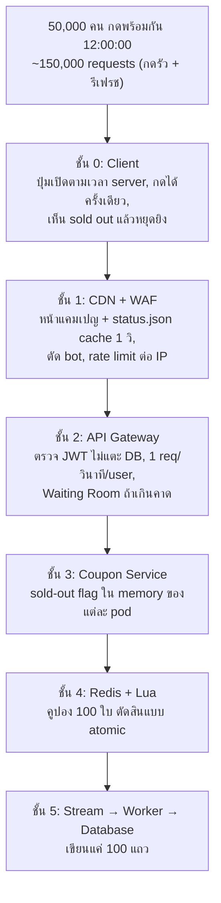
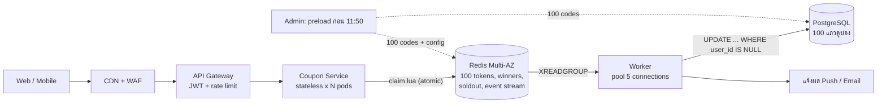
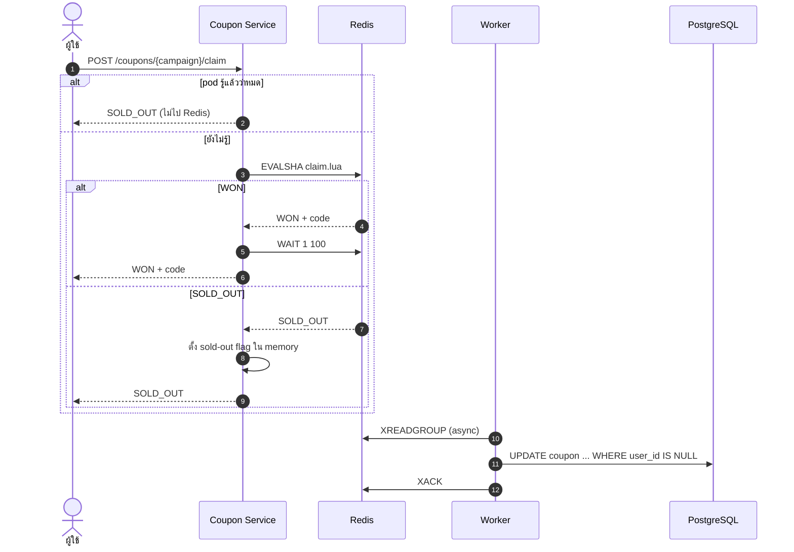

# ข้อ 3 — แจกคูปอง 100 สิทธิ์ ผู้ใช้หลักหมื่นคนกดพร้อมกัน: Database ต้องไม่ล่ม และห้าม Overbooking

> **โจทย์:** แจกคูปอง 100 สิทธิ์ ผู้ใช้หลักหมื่นคนกดเข้ามาพร้อมกันเวลา 12:00 น.
> ออกแบบ Architecture และ Logic อย่างไร ให้ Database ไม่ล่ม และไม่แจกเกิน 100 สิทธิ์

ข้อนี้ใช้ building block เดียวกับ [ข้อ 1](../01-flash-sale/1.1-high-level-architecture.md) แต่โจทย์ต่างกันตรงที่ **สิทธิ์น้อยมากเมื่อเทียบกับคน** จึงเน้น 2 เรื่องที่โจทย์ถาม: **ปกป้อง Database** และ **กัน Overbooking**

---

## 1. ตีโจทย์

| รายการ | ค่า |
|---|---|
| สิทธิ์ | 100 |
| ผู้ใช้ | "หลักหมื่น" — ออกแบบที่ 50,000 คน |
| คนที่ไม่ได้ | **99.8%** |
| คูปองหมดเมื่อไร | เสี้ยววินาทีแรก |

**หลักการ 2 ข้อ**

1. **Funnel — ปฏิเสธให้เร็วที่สุด ที่ชั้นนอกที่สุด ด้วยต้นทุนต่ำที่สุด** คำขอที่ไม่มีทางได้สิทธิ์ต้องไม่เดินทางลึกถึง Database
2. **Database อยู่นอก hot path** — ระหว่างแคมเปญไม่มีคำขอของผู้ใช้ตัวไหนอ่านหรือเขียน DB โดยตรง DB เห็นแค่ **การเขียน 100 แถว** ที่ Worker ทยอยทำ

---

## 2. Funnel: คำขอถูกกรองทีละชั้น



| ชั้น | สิ่งที่ถูกตัดทิ้ง | ต้นทุนต่อคำขอ |
|---|---|---|
| 0 Client | กดซ้ำ, กดก่อนเวลา, กดหลังรู้ว่าหมด | ฟรี |
| 1 CDN + WAF | อ่านหน้า/สถานะ (ตอบจาก cache), bot, IP ที่ยิงถี่ | ต่ำมาก ไม่ถึง server |
| 2 Gateway | ไม่ login, user ที่ยิงเกิน rate limit | ต่ำ |
| 3 Service | ทุกคำขอหลังรู้ว่าหมด | ต่ำ ไม่ถึง Redis |
| 4 Redis | ตัดสินผู้ได้ 100 คน ที่เหลือได้ `SOLD_OUT` | ต่ำ (in-memory) |
| 5 Database | — | เขียน 100 ครั้งเท่านั้น |

---

## 3. Architecture



---

## 4. Logic ที่ทำให้ Database ไม่ล่ม

| # | มาตรการ | ผล |
|---|---|---|
| 1 | **Preload ทุกอย่างก่อนเวลา** — config แคมเปญ, เวลาเปิด, คูปอง 100 ใบ ถูกโหลดเข้า Redis และ memory ของ pod ก่อน 11:50 | ระหว่างแคมเปญ **ไม่มีการอ่าน DB** |
| 2 | **ไม่มีการเขียน DB ใน request path** — ผู้ใช้ได้คำตอบจาก Redis, Worker เขียน DB ตามหลังผ่าน stream | DB **ถูกเขียนแค่ 100 ครั้ง** |
| 3 | **Worker ใช้ connection pool เล็ก** (เช่น 5) + batch | load ที่ DB คงที่ ไม่ว่าคนจะเข้ามากี่คน |
| 4 | **Auth ไม่แตะ DB** — gateway ตรวจ JWT ด้วย signature, บังคับ login ก่อน 12:00 | ไม่มี login storm ใส่ DB |
| 5 | **Negative caching** — เมื่อหมดแล้ว `status.json` บน CDN และ flag ใน pod บอกว่าหมด | คำขอหลังหมดไม่ถึง Redis ด้วยซ้ำ |
| 6 | **Fail closed** — ถ้า Redis มีปัญหา ตอบ `503 + Retry-After` | **ไม่ fallback ไปใช้ DB** ซึ่งจะลาก DB ล่ม |
| 7 | **Bulkhead** — แยก DB/schema หรืออย่างน้อย connection pool ของแคมเปญออกจากระบบหลัก | ถ้าแคมเปญมีปัญหา ระบบอื่นไม่ล่มตาม |
| 8 | **Timeout สั้น + circuit breaker** ทุกการเรียกข้ามระบบ | ไม่มี thread ค้างรอจนหมด pool |

---

## 5. Logic ที่กัน Overbooking

### 5.1 คูปองเป็น "token" 100 ใบใน Redis

สร้างโค้ดคูปอง 100 ใบไว้ล่วงหน้า ใส่ใน Redis LIST แล้วให้ Lua script หยิบด้วย `LPOP`
**LIST มี 100 ใบ → `LPOP` สำเร็จได้ไม่เกิน 100 ครั้ง → แจกเกิน 100 เป็นไปไม่ได้**

Lua script ชุดเดียวกับ [ข้อ 1.2](../01-flash-sale/1.2-concurrency-logic.md#ชั้น-4--redis--lua-script-ตัวตัดสินสิทธิ์) ทำทุกอย่างในขั้นเดียวแบบ atomic:

```lua
-- ย่อจากข้อ 1.2
if now_ms < start_at                    then return {'NOT_STARTED', ''} end
local mine = redis.call('HGET', winners, user_id)
if mine                                 then return {'ALREADY_CLAIMED', mine} end
local code = redis.call('LPOP', codes)
if not code then redis.call('SET', soldout, '1'); return {'SOLD_OUT', ''} end
redis.call('HSET', winners, user_id, code)
redis.call('XADD', events, '*', 'user_id', user_id, 'code', code)
return {'WON', code}
```

### 5.2 สิทธิ์น้อย จึงจ่ายเพิ่มเพื่อความทนทานได้

เพราะมีผู้ชนะแค่ 100 คน หลัง script คืน `WON` ให้ service เรียก `WAIT 1 100` (รอให้ replica ยืนยันได้รับ write อย่างน้อย 1 ตัว สูงสุด 100 ms) ก่อนตอบผู้ใช้
→ หน้าต่างที่ผู้ชนะจะหายเมื่อ Redis primary ล่มเหลือแค่หลักมิลลิวินาที และเสียเวลาเพิ่มแค่ 100 คำขอ

`WAIT` ลดความเสี่ยงได้ แต่ไม่ใช่การรับประกัน (replication ของ Redis ยังเป็นแบบ asynchronous) จึงใช้แผนเดียวกับข้อ 1.2 หัวข้อ "กรณีเลวร้ายที่สุด":
- เขียน **audit log ของทุกคำตอบ `WON`** แยกจาก Redis เพื่อใช้ตรวจย้อนหลัง
- เตรียม **reserve code** ไว้ชดเชยผู้ใช้ที่เห็นว่าได้แล้วแต่ข้อมูลหาย ตามที่ตกลงกับฝ่ายธุรกิจไว้ก่อน
- ถ้าธุรกิจยอมให้เกิดกรณีนี้ไม่ได้เลย ใช้ **Amazon MemoryDB** ที่ยืนยัน write ลงหลาย AZ ก่อนตอบ — กับคำขอที่ถึง Redis จริงไม่กี่พันครั้ง latency ที่เพิ่มขึ้นรับได้

### 5.3 Database เป็นด่านสุดท้าย: มีแค่ 100 แถว แต่ละแถวมีเจ้าของได้คนเดียว

```sql
CREATE TABLE coupon (
  code         VARCHAR(16) PRIMARY KEY,
  campaign_id  BIGINT      NOT NULL,
  user_id      BIGINT      NULL,                 -- NULL = ยังไม่มีเจ้าของ
  claimed_at   TIMESTAMPTZ NULL,
  CONSTRAINT uq_coupon_user UNIQUE (campaign_id, user_id)   -- 1 คน 1 ใบ
);
-- preload 100 แถวก่อนเวลา (ชุดเดียวกับใน Redis)
```

Worker เขียนด้วย **conditional update**:

```sql
UPDATE coupon
SET    user_id = $1, claimed_at = $2
WHERE  code = $3
  AND  user_id IS NULL;        -- ใบนี้ต้องยังไม่มีเจ้าของ
```

| ผล | ความหมาย | ทำอะไรต่อ |
|---|---|---|
| 1 row | สำเร็จ | `XACK` + ส่งแจ้งผล |
| 0 row, เจ้าของเป็น user เดิม | event ซ้ำ (เคยทำแล้ว) | `XACK` |
| 0 row, เจ้าของเป็นคนอื่น | Redis เสียข้อมูลตอน failover ทำให้ใบเดียวถูกแจกสองครั้ง | dead-letter + alert → เทียบ audit log แล้วชดเชยผู้ใช้ที่ได้รับผลกระทบด้วย reserve code |
| ชน `uq_coupon_user` | user นี้มีคูปองแล้ว (ไม่ควรเกิด) | dead-letter + alert |

**ผลเชิงโครงสร้าง:** ตารางมี 100 แถว แต่ละแถวมีเจ้าของได้คนเดียว และแต่ละคนมีได้ใบเดียว → **DB ไม่มีทางบันทึกผู้ได้สิทธิ์เกิน 100 คน** แม้ชั้นบนจะมี bug

### 5.4 สรุปชั้นกัน Overbooking

| ความเสี่ยง | กันด้วย |
|---|---|
| แจกเกิน 100 | LIST มี 100 token + `LPOP` ใน Lua (atomic) + DB มีแค่ 100 แถว |
| คนเดียวได้หลายใบ | `HGET winners` ใน Lua + DB `UNIQUE (campaign_id, user_id)` |
| ใบเดียวไปสองคน | `LPOP` หยิบได้ครั้งเดียว + DB `WHERE user_id IS NULL` |
| Redis ล่มแล้วเสียข้อมูล | replica คนละ AZ + `WAIT` + DB constraint + audit log + reserve code (หรือ MemoryDB) |
| Retry / กดซ้ำ | script คืนโค้ดเดิมให้ user เดิม (idempotent) |

---

## 6. Flow ของคำขอ 1 รายการ



---

## 7. ประสบการณ์ผู้ใช้ (ส่วนที่มักถูกลืม)

| ผลลัพธ์ | ข้อความ / การแสดงผล |
|---|---|
| `WON` | แสดงโค้ดทันที + ส่งซ้ำทาง Push/Email |
| `ALREADY_CLAIMED` | แสดงโค้ดเดิม |
| `SOLD_OUT` | "สิทธิ์เต็มแล้ว" + เสนอแคมเปญอื่น / ปุ่มรับแจ้งเตือนรอบถัดไป |
| `NOT_STARTED` | countdown ที่ sync กับเวลา server |
| `503` | "ระบบกำลังมีผู้ใช้จำนวนมาก กำลังลองใหม่ให้อัตโนมัติ" (client retry แบบ backoff) |

คน 99.8% จะได้ "สิทธิ์เต็ม" — ถ้าเขาได้คำตอบเร็วและชัด แบรนด์เสียน้อยกว่าให้หน้าเว็บหมุนค้างแล้ว error

---

## 8. ทางเลือกเชิงธุรกิจที่ SA ควรเสนอ: ลงทะเบียน + จับฉลาก

รูปแบบ "ใครกดเร็วได้ก่อน" เป็นตัว **สร้าง spike** ขึ้นเอง ถ้า business ยอมปรับกติกา ปัญหาทางเทคนิคส่วนใหญ่หายไป

| | กดเร็วได้ก่อน (FCFS) | ลงทะเบียน + จับฉลาก |
|---|---|---|
| วิธี | เปิด 12:00 ใครกดทันได้ | เปิดลงชื่อ 12:00–12:15 แล้วสุ่ม 100 คน ประกาศผล 12:30 |
| Load | spike ในไม่กี่วินาที | กระจายตลอด 15 นาที (ลดลงหลายสิบเท่า) |
| ความยุติธรรม | ได้เปรียบคนเน็ตเร็ว / bot | ทุกคนโอกาสเท่ากัน |
| ความซับซ้อนของระบบ | สูง | ต่ำ (insert 1 แถวต่อคน + job สุ่ม) |
| ความตื่นเต้นทางการตลาด | สูง | ปานกลาง |

SA เสนอทั้งสองแบบพร้อมต้นทุนและความเสี่ยง แล้วให้ business ตัดสิน — ถ้ายังต้องการ FCFS ก็ใช้ Architecture ข้างบน

---

## 9. Non-Functional Requirements, Monitoring และ Reconciliation

### 9.1 ตัวชี้วัดที่วัดได้

ใช้กรอบเดียวกับ [ข้อ 1.1 ส่วนที่ 9](../01-flash-sale/1.1-high-level-architecture.md) แต่ปรับเป้าตามโจทย์นี้ โดยเน้นสองเรื่องที่โจทย์ถาม

| # | Requirement | เป้าหมาย | วัดอย่างไร |
|---|---|---|---|
| N1 | **ไม่ Overbooking** | ผู้ได้สิทธิ์ **= 100 พอดี**, คนเดียวได้ซ้ำ = 0, ใบเดียวสองคน = 0 | SQL reconcile + alert ทันทีถ้า `HLEN winners` > 100 |
| N2 | **DB ไม่ล่ม** | คำขอของผู้ใช้ที่อ่าน / เขียน DB ระหว่างแคมเปญ = 0, DB CPU ≤ 50%, connection ที่ใช้ ≤ pool ของ worker | metrics ของ DB + query log |
| N3 | Latency ของ Claim API | p95 ≤ 300 ms (รวม `WAIT` ≤ 100 ms ของผู้ชนะ), p99 ≤ 1 s | histogram ที่ API Gateway |
| N4 | Throughput | รับ ~150,000 คำขอใน 10 วินาทีแรก (≈ 15,000 req/s) โดย N3 และ N5 ยังผ่าน | load test ก่อนวันจริง |
| N5 | Availability | ≥ 99.9% ของคำขอได้คำตอบที่ไม่ใช่ 5xx (ไม่นับ 429) | log ของ API Gateway |
| N6 | Durability | ผู้ชนะถูกบันทึกลง DB ภายใน 60 วินาที และหาย = 0 | stream lag + เทียบ audit log กับ DB |
| N7 | Isolation | p95 ของระบบหลักเปลี่ยนไม่เกิน 10% | APM dashboard เทียบ baseline |

**Go / No-go:** load test และ chaos test (kill worker, Redis failover) ต้องผ่าน N1–N5 ก่อนอนุมัติเปิดแคมเปญ

### 9.2 Monitoring ระหว่างแคมเปญ

**ระหว่างแคมเปญ (dashboard real-time)**
- คูปองคงเหลือ (`LLEN codes`), ผู้ชนะ (`HLEN winners`), stream lag, จำนวนแถวใน DB ที่มีเจ้าของ
- RPS แยกตามชั้น, p95 latency, อัตรา `429 / 503`, CPU/memory ของ Redis
- **Alert ทันที** ถ้าจำนวนผู้ชนะใน Redis หรือ DB > 100 (ตามการออกแบบเป็นไปไม่ได้ แต่ต้องเฝ้า)

### 9.3 Reconciliation หลังจบแคมเปญ

- Reconcile: `HLEN winners` = `SELECT COUNT(*) FROM coupon WHERE user_id IS NOT NULL` = 100
- stream ไม่มี pending ค้าง, dead-letter ว่าง, ทุก `CLAIM_WON` ใน audit log มีแถวตรงกันใน DB
- สรุป post-campaign review: เทียบค่าจริงกับเป้า N1–N7 และ peak จริงกับที่ประเมิน ใช้ปรับขนาดแคมเปญครั้งถัดไป

---

## 10. ต่างจากข้อ 1 อย่างไร

| | ข้อ 1 (1,000 สิทธิ์) | ข้อ 3 (100 สิทธิ์) |
|---|---|---|
| คนที่ไม่ได้ | 98% | 99.8% |
| จุดเน้น | ภาพรวม component ทั้งระบบ | ปกป้อง DB + กัน overbooking |
| ความทนทานของ Redis | replica + `WAIT 50 ms` + audit log | `WAIT 100 ms` ได้สบาย เพราะมีผู้ชนะแค่ 100 คน (+ audit log เหมือนกัน) |
| การเขียน DB | `INSERT ... ON CONFLICT DO NOTHING` | `UPDATE ... WHERE user_id IS NULL` บนแถวที่ preload ไว้ |
| ข้อเสนอเพิ่ม | — | เสนอ business ให้พิจารณารูปแบบจับฉลาก |
